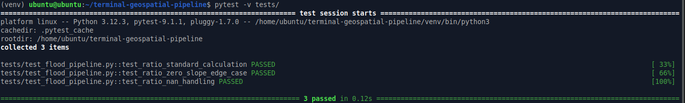

# Terminal-Based Geospatial Pipeline & Validation
**Author:** Muhammad Umar Bilal | [ORCID: 0009-0002-6335-815X](https://orcid.org/0009-0002-6335-815X)

## Overview
This repository demonstrates a lightweight, terminal-native computational workflow for Earth Sciences, specifically focusing on feature engineering for Flood Susceptibility modeling. It is designed to showcase robust QA/QC practices, numerical stability, and automated testing for scientific computing tasks.



## Project Context
This codebase is extracted from my broader Random Forest flood susceptibility project (which achieved a test ROC-AUC of 0.9875). The focus here is on the rigorous validation of scientific data transformations, specifically handling edge cases that commonly break AI agents in automated grading environments.

**Note:** To protect proprietary intellectual property, this repository contains an extracted, lightweight validation module rather than the full production pipeline. It demonstrates the core QA/QC and testing logic used in the broader application.

## Features
- **Deterministic Data Transformation:** Calculates the elevation-to-slope ratio used in geophysical modeling.
- **Edge-Case Handling:** Explicitly prevents `ZeroDivisionError` and `Infinity` (Inf) outputs when slope values approach zero.
- **Missing Data Management:** Deterministic handling of `NaN` values to ensure pipeline stability.
- **Automated Testing:** Uses `pytest` to assert numerical tolerances and output validity.

## How to Run
**1. Install dependencies:**
  ```bash
   pip install -r requirements.txt
  ```
**2. Run the automated test suite:**
  ```bash
   pytest -v tests/
  ```
## Relevance to Terminal Bench Science

In scientific AI task design, agents must be able to process spatial data without breaking numerical constraints. This repository demonstrates the exact QA/QC rigor required to define objective grading criteria, validate coordinate units, and ensure deterministic reproducibility in headless Linux environments. 